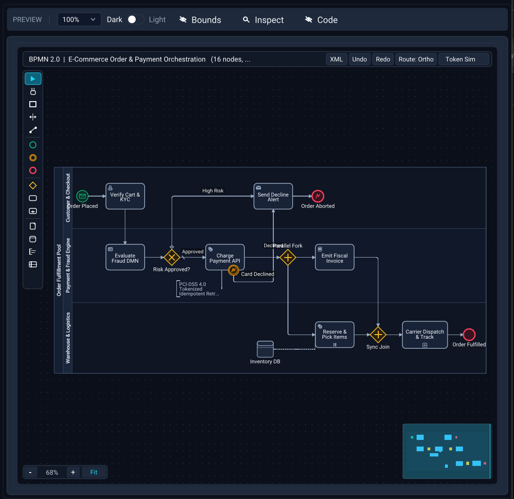

# guikit/diagram

Interactive BPMN 2.0 Diagram Modeler & Live Token Simulator (`BpmnEditor`) for **[GuiKit](https://github.com/guikit/guikit)**.



## Highlights

- **Full BPMN 2.0 Modeling (`bpmn-js` parity)**: Start/Intermediate/End events, User/Service/Script/Manual tasks, Exclusive/Parallel/Inclusive gateways, pools & swimlanes, annotations, and sequence/message flows.
- **Interactive Authoring**: Left creation palette, floating context pad, orthogonal Manhattan waypoint routing, marquee multi-selection, undo/redo history, and inline label editing.
- **Live Token Simulation**: Step through or run animated process tokens directly inside the diagram canvas with gateway branching and completion tracking.

## Quick Usage

```cpp
#include "guikit/guikit.hpp"
#include "guikit/diagram.hpp"

guikit::diagram::BpmnEditor(ui, bpmnModel, {.height = guikit::SizeMode::Stretch});
```

## CMake Integration

```cmake
add_subdirectory(guikit)
add_subdirectory(diagram)

target_link_libraries(my_app PRIVATE guikit::guikit guikit::diagram)
```

For the unified workspace and full interactive showcase (`guikit_demo`), see **[`guikit/bundle`](https://github.com/guikit/bundle)**.

## License

BSD Zero Clause License (`0BSD`). See [LICENSE](LICENSE) for details.
